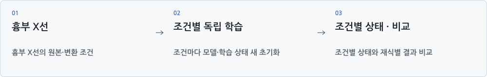

<!-- readme-header32:start -->

<h1 align="center" id="project-title">흉부 엑스레이 환자 재식별 실험</h1>

변환 조건별 흉부 X선 재식별 실험

  
  

  
  
  
  
  

<picture>
  <source media="(max-width: 600px) and (prefers-color-scheme: dark)" srcset="assets/readme/flow-ko-dark-mobile.svg" />
  <source media="(max-width: 600px)" srcset="assets/readme/flow-ko-light-mobile.svg" />
  <source media="(prefers-color-scheme: dark)" srcset="assets/readme/flow-ko-dark.svg" />
  <source media="(prefers-color-scheme: light)" srcset="assets/readme/flow-ko-light.svg" />
  
</picture>
<!-- readme-header32:end -->

## 현재 실행 정책 · 10차 처음부터

7차 학습과 이전 대기열을 중단하고 보관했으며 10차 새 원본 original_000부터 시작합니다. 원본 1·블러 10·모자이크 10의 21조건을 공통 ImageNet 초기값·시드3에서 각각 새로 학습합니다. 7차 완료를 기다리거나 이전 CXR 체크포인트를 넘겨받지 않습니다.

| 구분 | 현재 동작 | 보존 범위 |
| --- | --- | --- |
| 상단 학습 |10차 새 원본의 진행·손실·실행 관측 |7차 기록을 현재 진행으로 대신 표시하지 않음 |
| 강도별 학습 |20조건 버튼과 새 원본 상세를 별도 조회 | 각 조건의 초기화·학습·같은 조건 평가만 결합 |
| 이전7차 | 사용자 요청으로 중단한 보관 이력 | 고정모델84평가를 새21모델 결과와 합치지 않음 |

아래 이전 설명의 ‘7차 유지·원본 완료 대기’는 재시작 요청 이전 설계로 보존하며 현재 동작을 뜻하지 않습니다. 새 실행의 준비·학습·완료 여부는 실제 기록으로 확인합니다. 외부 GPU 프로세스 목록은 관측 정보이며 CXR 중복 실행을 차단하고 기존 단계별 메모리 여유 기준은 유지합니다. CPU 실변환 검사는 import 시간 상한으로 미완료이며 실제21조건 학습 완료를 주장하지 않습니다.

10차 재시작 이전의 설계

원본7차 학습을 보존하면서 **블러·모자이크 강도마다 모델을 새로 학습하는10차**를 추가합니다. 기존7차의 고정 모델 변환 평가와10차의 조건별 재학습은 서로 다른 실험입니다. 대시보드는 실제 기록을 읽는 화면이며 학습 완료를 뜻하지 않습니다.

| 구분 | 학습과 평가 방식 |
| --- | --- |
| 원 ⁠본 | 기존 7차 검증·검색 모델의 학습과 평가를 유지합니다. |
| 독립 학습 | 블러 10 조건·모자이크 10 조건에서 모델과 학습 상태를 각각 새로 초기화합니다. |
| 실행 순서 | 원본 전체가 정상 종료된 것을 확인한 뒤 한 조건씩 진행합니다. 대기 상태를 학습 중으로 표시하지 않습니다. |
| 결과 해석 | 원본 모델의 21 조건 평가와 새 조건별 학습 결과를 분리합니다. 미측정은 미측정으로 남깁니다. |

## 읽기 수준

| 읽기 수준 | 설명의 출발점 |
| --- | --- |
| [LEVEL 1 - Beginner](docs/읽기안내/레벨1.md) | 배경과 용어부터 |
| [LEVEL 2 - Explorer](docs/읽기안내/레벨2.md) | 구성과 연결 원리 |
| [LEVEL 3 - Practitioner](docs/읽기안내/레벨3.md) | 실제 실행과 결과 확인 |
| [LEVEL 4 - Advanced](docs/읽기안내/레벨4.md) | 구현과 실패 처리 |
| [LEVEL 5 - Expert](docs/읽기안내/레벨5.md) | 논문·코드·프로토콜 검토 |

[10차 사용법과 한계](10차/README.md) · [강도별 학습 실행 안내](10차/학습안내.md) · [전체 차수 목차](문서/차수_목차.md)

## 전체 차수

| 차⁠수 | 핵심 변경 | 자료 |
| --- | --- | --- |
| 1⁠차 | 로컬 실험 제어와 화면 | [폴더](1차/) · [상세](1차/README.md) · [직전 비교](1차/COMPARISON.md) |
| 2⁠차 | 평가 재현 정밀 감사 | [폴더](2차/) · [상세](2차/README.md) · [직전 비교](2차/COMPARISON.md) |
| 3⁠차 | 새 학습 경로 분리 | [폴더](3차/) · [상세](3차/README.md) · [직전 비교](3차/COMPARISON.md) |
| 4⁠차 | 한글 경로와 NIH 중복 방어 | [폴더](4차/) · [상세](4차/README.md) · [직전 비교](4차/이전_차수_비교.md) |
| 5⁠차 | COVID 외부검증 정제 | [폴더](5차/) · [상세](5차/README.md) · [직전 비교](5차/이전_차수_비교.md) |
| 6⁠차 | 평가 단계·강도 탐색 | [폴더](6차/) · [상세](6차/README.md) · [직전 비교](6차/이전_차수_비교.md) |
| 7⁠차 | 저자 원본 목록 기반 새 학습 | [폴더](7차/) · [상세](7차/README.md) · [직전 비교](7차/이전_차수_비교.md) |
| 8 ⁠차 | 7차 실시간 연결과 실행 분리 | [폴더](8차/) · [상세](8차/README.md) · [직전 비교](8차/이전_차수_비교.md) |
| 9⁠차 | 학습 진행률·세 단계·손실 추이 | [폴더](9차/) · [상세](9차/README.md) · [직전 비교](9차/이전_차수_비교.md) |
| 10⁠차 | 강도별 독립 학습과 조건별 상태 조회 | [폴더](10차/) · [상세](10차/README.md) · [직전 비교](10차/이전_차수_비교.md) |

10차는 원영상에 변환을 적용한 뒤 그 조건의 검증·검색 모델을 새로 학습하는 확장 실험입니다. NIH 학습과 COVID-19 외부 평가를 구분합니다. 원저자 목록의 중복 한계,4~6차 정제 파생 실험과 7차 원본 기반 실험의 차이를 보존합니다. 원 논문 전체를 그대로 재현했다거나 익명성이 보장됐다고 주장하지 않습니다.

9차까지의 첫 화면과 이전 안내 원문

## 9차까지의 첫 화면 원문

아래는 9차까지의 안내 원문입니다. 당시 현재 화면·학습 연결에 대한 설명을 현재 10차 강도별 독립 학습으로 소급해 읽지 않습니다.

# 흉부 엑스레이 환자 재식별 실험

같은 7차 환자 재식별 학습을 읽는 **9차 학습 진행 화면**입니다. 에폭 안의 배치 진행, 현재 학습 단계, 실제 손실의 관측 추이를 구분합니다. 화면 변경으로 학습 설정·가중치·데이터 분할을 바꾸지 않습니다.

| 읽기 수준 | 설명의 출발점 |
| --- | --- |
| [LEVEL 1 - Beginner](docs/읽기안내/레벨1.md) | 배경과 용어부터 |
| [LEVEL 2 - Explorer](docs/읽기안내/레벨2.md) | 구성과 연결 원리 |
| [LEVEL 3 - Practitioner](docs/읽기안내/레벨3.md) | 실제 실행과 결과 확인 |
| [LEVEL 4 - Advanced](docs/읽기안내/레벨4.md) | 구현과 실패 처리 |
| [LEVEL 5 - Expert](docs/읽기안내/레벨5.md) | 논문·코드·프로토콜 검토 |

## 현재 화면과 계산

| 구분 | 역할 | 확인할 한계 |
| --- | --- | --- |
|9차 화면 | 에폭·학습 단계의 진행 막대와 세 단계 흐름, 실제 손실 기록 표시 | 전체 실험 시간 완료율이나 최종 시험 성능이 아님 |
|7차 실험 | 저자 원본 목록 기반 검증·검색 학습과 고정 모델 변환 평가 | 전체 학습·평가 완료는 실제 결과로 별도 확인 |
| 기록 읽기 | 최근 관측 범위·마지막 시각·원값을 함께 확인 | 기록이 없으면 미측정, 부분 이력을 전체 곡선으로 부르지 않음 |
| 실행 분리 | 표시용 창·화면 서버와 학습 실행기를 구분 | 표시만 닫는 일과 실행기 전체 종료·재부팅은 다름 |

검증 모델은 최대 100에폭과 조기 종료 규칙, 검색 출력 부는 30에폭, 검색 전체는 50에폭을 유지합니다.

세 과정의 단순 평균을 전체 실험 시간 비율로 표시하지 않습니다.

손실 감소는 정확도·익명성 보장이 아닙니다. 원 논문과 공식 코드의 차이는 [8차 재검토](8차/논문과_실행_재검증.md), 이번 화면의 계산·사용법·한계는 [9차 상세](9차/README.md)에서 확인합니다.

## 전체 차수

| 차&#8288;수 | 핵심 변경 | 자료 |
| --- | --- | --- |
| 1&#8288;차 | 로컬 실험 제어와 화면 | [폴더](1차/) · [상세](1차/README.md) · [직전 비교](1차/COMPARISON.md) |
| 2&#8288;차 | 평가 재현 정밀 감사 | [폴더](2차/) · [상세](2차/README.md) · [직전 비교](2차/COMPARISON.md) |
| 3&#8288;차 | 새 학습 경로 분리 | [폴더](3차/) · [상세](3차/README.md) · [직전 비교](3차/COMPARISON.md) |
| 4&#8288;차 | 한글 경로와 NIH 중복 방어 | [폴더](4차/) · [상세](4차/README.md) · [직전 비교](4차/이전_차수_비교.md) |
| 5&#8288;차 | COVID 외부검증 정제 | [폴더](5차/) · [상세](5차/README.md) · [직전 비교](5차/이전_차수_비교.md) |
| 6&#8288;차 | 평가 단계·강도 탐색 | [폴더](6차/) · [상세](6차/README.md) · [직전 비교](6차/이전_차수_비교.md) |
| 7&#8288;차 | 저자 원본 목록 기반 새 학습 | [폴더](7차/) · [상세](7차/README.md) · [직전 비교](7차/이전_차수_비교.md) |
| 8 &#8288;차 | 7차 실시간 연결과 실행 분리 | [폴더](8차/) · [상세](8차/README.md) · [직전 비교](8차/이전_차수_비교.md) |
| 9&#8288;차 | 학습 진행률·세 단계·손실 추이 | [폴더](9차/) · [상세](9차/README.md) · [직전 비교](9차/이전_차수_비교.md) |

[전체 차수 목차](문서/차수_목차.md) · [변경 기록](변경_기록.md)

## 8차까지의 첫 화면 원문

아래는 8차까지의 실제 안내입니다. 당시 현재 화면 8차와 그 이전 6차 원문을 보존하며 현재 9차의 동작으로 소급해 읽지 않습니다.

원본·블러·모자이크 조건에서 환자 재식별 모델의 학습과 평가를 관찰하는 로컬 연구 도구입니다. **8차 화면은 7차 실험을 조회**합니다.

| 읽기 수준 | 설명의 출발점 |
| --- | --- |
| [LEVEL 1 - Beginner](docs/읽기안내/레벨1.md) | 배경과 용어부터 |
| [LEVEL 2 - Explorer](docs/읽기안내/레벨2.md) | 구성과 연결 원리 |
| [LEVEL 3 - Practitioner](docs/읽기안내/레벨3.md) | 실제 실행과 결과 확인 |
| [LEVEL 4 - Advanced](docs/읽기안내/레벨4.md) | 구현과 실패 처리 |
| [LEVEL 5 - Expert](docs/읽기안내/레벨5.md) | 논문·코드·프로토콜 검토 |

## 현재 연결

| 항목 | 동작 |
| --- | --- |
| 화면 |8차 server.mjs, 로컬 8787 포트 |
| 실험 |7차 현재 실행 기록 읽기 |
| 실험 제어 |조회 화면과 별도 실행, 화면에서 학습 종료 불가 |
| 측정 |42 데이터 행·84과 제 조건, 미측정은 미측정 |

원 논문과의 정합 확인, 저장 오류 및 재개 관측은 8차의 검증 기록에서 별도로 설명합니다. 7차는 저 자 원본 목록·validation CBM 동작을 유지하고,4~6차는 중복 제거·검증 큐 방어를 적용한 파생 설계입니다.

둘을 같은 실험이라고 부르지 않습니다.

강도별 재학습은 하지 않으며 같은 모델로 변환 조건을 평가합니다.

## 전체 차수

| 차&#8288;수 | 핵심 변경 | 자료 |
| --- | --- | --- |
| 1&#8288;차 | 로컬 실험 제어와 화면 | [폴더](1차/) · [상세](1차/README.md) · [직전 비교](1차/COMPARISON.md) |
| 2&#8288;차 | 평가 재현 정밀 감사 | [폴더](2차/) · [상세](2차/README.md) · [직전 비교](2차/COMPARISON.md) |
| 3&#8288;차 | 새 학습 경로 분리 | [폴더](3차/) · [상세](3차/README.md) · [직전 비교](3차/COMPARISON.md) |
| 4&#8288;차 | 한글 경로와 NIH 중복 방어 | [폴더](4차/) · [상세](4차/README.md) · [직전 비교](4차/이전_차수_비교.md) |
| 5&#8288;차 | COVID 외부검증 정제 | [폴더](5차/) · [상세](5차/README.md) · [직전 비교](5차/이전_차수_비교.md) |
| 6&#8288;차 | 평가 단계·강도 탐색 | [폴더](6차/) · [상세](6차/README.md) · [직전 비교](6차/이전_차수_비교.md) |
| 7&#8288;차 | 저자 원본 목록 기반 새 학습 | [폴더](7차/) · [상세](7차/README.md) · [직전 비교](7차/이전_차수_비교.md) |
| 8 &#8288;차 | 7차 실시간 연결과 실행 분리 | [폴더](8차/) · [상세](8차/README.md) · [직전 비교](8차/이전_차수_비교.md) |

## 6차까지의 기존 안내 원문

## 흉부 엑스레이 환자 재식별 실험

환자 재식별 모델을 새로 학습하고 원본·블러·모자이크의 재식별 성능을 비교하는 로컬 연구 도구입니다. 공개 CXR 최종 가중치를 사용하는 평가와 ImageNet 초기화에서 시작하는 새 학습을 구분합니다.

## 현재 화면

6차 화면은 기존 5차 실험을 연결해 학습 3 과정과 평가 3 단계·21 강도 조건의 상세를 구분합니다. 각 강도별 재학습을 수행하는 구조가 아니며 같은 새 모델로 평가합니다. 반올림 100.0%와 실제 원비율 1을 구분하고 원값을 펼쳐 확인합니다.

## 현재 실험

NIH 원본 112,120장 전수 검사에서 정확한 픽셀 중복 25 그룹을 확인했습니다.

환자 기록이 다른 동일 영상은 모두 제외하고, 같은 환자의 동일 영상은 한 장만 남기는 파생 실험 목록을 만듭니다.

원본·공식 분할·3차의 차단 기록은 보존합니다. 4차는 이 누수 방어와 한글 경로·모션 버튼 수정을 반영합니다.

이후 COVID 외부 검증 자료에서도 서로 다른 환자 ID의 동일 픽셀 2 그룹을 발견해 준비를 차단했습니다. 5차는 원본 781장 중 환자 충돌 4장을 제외한 777장·1,534 쌍으로 외부 평가 집합을 일관되게 파생합니다.

양성 772 쌍·음성 762 쌍이라는 실제 분모를 유지하며 임의 균형 보충은 하지 않습니다.

이번 실험은 논문 주요 조건을 기반으로 중복과 검증 메모리 혼입을 차단한 재학습입니다. 원 논문 환경·모든 분석·공식 데이터 구성을 그대로 복제했다고 주장하지 않습니다. 학습 시작·종료·논문 수치 재현 여부는 실제 실행 결과를 따로 확인합니다.

## 전체 차수

| 차수 | 자료 | 설명 | 직전 비교 |
| --- | --- | --- | --- |
| 1차 | [코드](1차/) | [설명](1차/README.md) | [최초 추가](1차/COMPARISON.md) |
| 2차 | [감사](2차/) | [설명](2차/README.md) | [감사 내용](2차/COMPARISON.md) |
| 3차 | [새 학습 경로](3차/) | [설명](3차/README.md) | [변경 비교](3차/COMPARISON.md) |
| 4차 | [수정 코드](4차/) | [설명](4차/README.md) | [한글 경로·화면·누수 수정](4차/이전_차수_비교.md) |
| 5차 | [외부검증 중복 제거](5차/) | [설명](5차/README.md) | [4차와 전체 비교](5차/이전_차수_비교.md) |
| 6차 | [단계·강도 탐색](6차/) | [설명](6차/README.md) | [5차와 전체 비교](6차/이전_차수_비교.md) |

[차수 목차](문서/차수_목차.md) · [변경 기록](변경_기록.md)

## ▶️ 화면과 실행

흰색·회청색 화면에서 준비·학습·평가를 구분하고 실제 GPU·학습 진행·결과를 확인합니다.

백분율은 소수 첫째 자리까지 반올림해 표시하며 저장 원비율과 전체 정밀도 값을 펼쳐 확인합니다.

다크·라이트와 모션 제어를 제공합니다.

변환 미리 보기는 평가 결과가 아닙니다.

Node.js로 `6차/server.mjs`를 실행하면 로컬 포트 8787에서 대시보드를 확인할 수 있습니다.

새 학습 코드는 `5차/실험 코드/training/`에 있습니다. 실행 관리자는 로컬 Python 환경과 평가 엔진·데이터를 필요로 합니다. 제공 평가 패키지의 재배포 권한이 미확인이라 전체 평가 엔진은 포함하지 않았습니다. 이 공개 사본만으로 전체 실험을 실행할 수 있다는 뜻은 아닙니다.

## 지표와 공개 경계

프라이버시 점수 `100 × (1 − CMC@1)`는 고정된 공격 모델·검색 집합에서의 1 순위 재식별 실패율입니다. 익명성 보장이나 종합 개인 정보 보호 수준을 뜻하지 않습니다. 자기 원본과 동일 픽셀 중복을 이용한 우회를 차단하며, 변경된 질의·검색 집합 분모를 기록합니다.

의료 원영상·영상별 목록·환자 식별자·가중치·실행 로그·개인 지침과 기억은 공개하지 않습니다. 원 저자 코드의 GPL, PML의 MIT 출처와 글꼴 OFL을 보존하며 전체 저장소에 새 포괄 라이선스를 부여하지 않습니다.

- [Packhäuser 등 원 논문](https://doi.org/10.1038/s41598-022-19045-3)
- [고정한 원 저자 코드](https://github.com/kaipackhaeuser/CXR-Patient-ReID/tree/880168f564afa07936a8d8fb3b868b140ab937d9)

## 이전 원격 첫 화면 보존

[11/13시점 원격 설명(보존)](https://github.com/PUVKID/CXR-Privacy-Lab/blob/2434a1e29533a74b7acc60a6799c8da550c91ac7/README.md)은 6차 화면·5차 파생 실험을 설명하던 첫 화면입니다.

당시의 표·설정·실행 안내 전체를 보존하며 현재 8차 화면·7차 원본 기반 실험과 구분합니다.

각 수준의 과거 설명은 현재 LEVEL1~5 안내에 연결했습니다.

