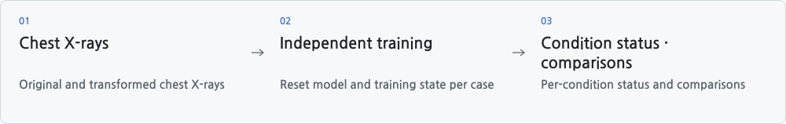

<!-- readme-header32:start -->

<h1 align="center" id="project-title">Chest X-ray Patient Re-identification Experiment</h1>

Chest X-ray re-identification under image transformations

  
  

  
  
  
  
  

<small>LEVEL links open the Korean source at the same reading level.</small>

<picture>
  <source media="(max-width: 600px) and (prefers-color-scheme: dark)" srcset="../assets/readme/flow-en-dark-mobile.svg" />
  <source media="(max-width: 600px)" srcset="../assets/readme/flow-en-light-mobile.svg" />
  <source media="(prefers-color-scheme: dark)" srcset="../assets/readme/flow-en-dark.svg" />
  <source media="(prefers-color-scheme: light)" srcset="../assets/readme/flow-en-light.svg" />
  
</picture>
<!-- readme-header32:end -->

## Current execution policy: revision 10 starts from scratch

Revision 7 training and the previous queue were stopped and archived. Execution starts with the new revision 10 original condition, original_000. The 21 conditions—1 original, 10 blur, and 10 mosaic—each train a new model from the common ImageNet initialization with seed 3. They do not wait for revision 7 to finish or inherit an earlier CXR checkpoint.

| Area | Current behavior | Preservation boundary |
| --- | --- | --- |
| Top training panel | Progress, loss, and runtime observations for the new revision 10 original condition | Does not substitute revision 7 records for current progress |
| Training by strength | Separately query the 20 condition buttons and the new original-condition details | Combines only each condition's initialization, training, and evaluation under that same condition |
| Earlier revision 7 | Archived history stopped at the user's request | Does not combine the fixed model's 84 evaluations with results from the 21 new models |

The earlier descriptions below saying “keep revision 7 running and wait for the original condition to finish” preserve the design before the restart request; they do not describe current behavior. Actual records determine whether the new execution is prepared, training, or complete. External GPU process lists are observations; duplicate CXR runs are blocked and the existing stage-specific memory-headroom criteria remain in place. The CPU check using actual transformations remains incomplete because of the import-time limit. Completion of training for all 21 conditions is not claimed.

Design before the revision 10 restart

While preserving revision 7 training on the original condition, revision 10 adds **a newly trained model for every blur and mosaic strength**. Evaluation of transformed inputs with revision 7's fixed model and condition-specific retraining in revision 10 are different experiments. The dashboard reads actual records; it does not signify completed training.

| Category | Training and evaluation method |
| --- | --- |
| Original | Preserve training and evaluation of the existing revision 7 verification and retrieval models. |
| Independent training | Initialize the model and training state separately for each of the 10 blur and 10 mosaic conditions. |
| Execution order | After confirming that the entire original-condition run ended normally, proceed one condition at a time. Do not label waiting as training. |
| Interpreting results | Separate the original model's evaluation on 21 conditions from the newly trained results for each condition. Unmeasured results remain unmeasured. |

## Reading levels

| Reading level | Starting point |
| --- | --- |
| [LEVEL 1 - Beginner (Korean source)](../docs/읽기안내/레벨1.md) | Background and terminology |
| [LEVEL 2 - Explorer (Korean source)](../docs/읽기안내/레벨2.md) | Structure and connections |
| [LEVEL 3 - Practitioner (Korean source)](../docs/읽기안내/레벨3.md) | Running the experiment and checking results |
| [LEVEL 4 - Advanced (Korean source)](../docs/읽기안내/레벨4.md) | Implementation and failure handling |
| [LEVEL 5 - Expert (Korean source)](../docs/읽기안내/레벨5.md) | Reviewing the paper, code, and protocol |

[Revision 10 usage and limitations (Korean source)](../10차/README.md) · [Training by strength (Korean source)](../10차/학습안내.md) · [Full revision index (Korean source)](../문서/차수_목차.md)

## All revisions

| Revision | Main change | Materials |
| --- | --- | --- |
| 1 | Local experiment controls and screen | [Folder (Korean source)](../1차/) · [Details (Korean source)](../1차/README.md) · [Previous comparison (Korean source)](../1차/COMPARISON.md) |
| 2 | Detailed audit of evaluation reproducibility | [Folder (Korean source)](../2차/) · [Details (Korean source)](../2차/README.md) · [Previous comparison (Korean source)](../2차/COMPARISON.md) |
| 3 | Separate new-training path | [Folder (Korean source)](../3차/) · [Details (Korean source)](../3차/README.md) · [Previous comparison (Korean source)](../3차/COMPARISON.md) |
| 4 | Korean paths and protection against NIH duplicates | [Folder (Korean source)](../4차/) · [Details (Korean source)](../4차/README.md) · [Previous comparison (Korean source)](../4차/이전_차수_비교.md) |
| 5 | Refined external COVID validation | [Folder (Korean source)](../5차/) · [Details (Korean source)](../5차/README.md) · [Previous comparison (Korean source)](../5차/이전_차수_비교.md) |
| 6 | Exploring evaluation stages and transformation strengths | [Folder (Korean source)](../6차/) · [Details (Korean source)](../6차/README.md) · [Previous comparison (Korean source)](../6차/이전_차수_비교.md) |
| 7 | New training based on the authors' original lists | [Folder (Korean source)](../7차/) · [Details (Korean source)](../7차/README.md) · [Previous comparison (Korean source)](../7차/이전_차수_비교.md) |
| 8 | Live connection to revision 7 and separate execution | [Folder (Korean source)](../8차/) · [Details (Korean source)](../8차/README.md) · [Previous comparison (Korean source)](../8차/이전_차수_비교.md) |
| 9 | Training progress, three stages, and loss trends | [Folder (Korean source)](../9차/) · [Details (Korean source)](../9차/README.md) · [Previous comparison (Korean source)](../9차/이전_차수_비교.md) |
| 10 | Independent training per strength and per-condition status | [Folder (Korean source)](../10차/) · [Details (Korean source)](../10차/README.md) · [Previous comparison (Korean source)](../10차/이전_차수_비교.md) |

Revision 10 is an extension experiment that transforms the original images and then newly trains that condition's verification and retrieval models. NIH training and external COVID-19 evaluation remain distinct. The duplicate limitations in the original authors' lists and the differences between the refined derivative experiments in revisions 4–6 and the original-list experiment in revision 7 are preserved. Exact reproduction of the entire original paper or guaranteed anonymity is not claimed.

Home page and earlier guide through revision 9

## Original home page through revision 9

The following is the original guide through revision 9. Its descriptions of the then-current screen and training connection must not be retroactively read as revision 10's current independent training by strength.

# Chest X-ray Patient Re-identification Experiment

This is the **revision 9 training-progress screen** reading the same revision 7 patient re-identification training. It distinguishes batch progress within an epoch, the current training stage, and observed trends in actual loss. Screen changes do not alter training settings, weights, or data splits.

| Reading level | Starting point |
| --- | --- |
| [LEVEL 1 - Beginner (Korean source)](../docs/읽기안내/레벨1.md) | Background and terminology |
| [LEVEL 2 - Explorer (Korean source)](../docs/읽기안내/레벨2.md) | Structure and connections |
| [LEVEL 3 - Practitioner (Korean source)](../docs/읽기안내/레벨3.md) | Running the experiment and checking results |
| [LEVEL 4 - Advanced (Korean source)](../docs/읽기안내/레벨4.md) | Implementation and failure handling |
| [LEVEL 5 - Expert (Korean source)](../docs/읽기안내/레벨5.md) | Reviewing the paper, code, and protocol |

## Current screen and calculations

| Area | Role | Limitation to check |
| --- | --- | --- |
| Revision 9 screen | Shows epoch and training-stage progress bars, the three-stage flow, and actual loss records | Not the completion percentage of total experiment time or final test performance |
| Revision 7 experiment | Verification and retrieval training based on the authors' original lists, plus transformed-input evaluation with a fixed model | Completion of all training and evaluation must be checked separately from actual results |
| Reading records | Check the recent observation window, latest timestamp, and raw values together | No record means unmeasured; a partial history is not called a full curve |
| Separating execution | Distinguish the display window and screen server from the training runner | Closing only the display differs from terminating the entire runner or rebooting |

The verification model retains the maximum 100 epochs and early-stopping rules; the retrieval output head retains 30 epochs, and the full retrieval stage retains 50 epochs.

The simple average of progress in the three processes is not presented as the fraction of total experiment time.

Decreasing loss does not guarantee accuracy or anonymity. See the [revision 8 reassessment (Korean source)](../8차/논문과_실행_재검증.md) for differences between the original paper and official code, and [revision 9 details (Korean source)](../9차/README.md) for the screen's calculations, usage, and limitations.

## All revisions

| Revision | Main change | Materials |
| --- | --- | --- |
| 1 | Local experiment controls and screen | [Folder (Korean source)](../1차/) · [Details (Korean source)](../1차/README.md) · [Previous comparison (Korean source)](../1차/COMPARISON.md) |
| 2 | Detailed audit of evaluation reproducibility | [Folder (Korean source)](../2차/) · [Details (Korean source)](../2차/README.md) · [Previous comparison (Korean source)](../2차/COMPARISON.md) |
| 3 | Separate new-training path | [Folder (Korean source)](../3차/) · [Details (Korean source)](../3차/README.md) · [Previous comparison (Korean source)](../3차/COMPARISON.md) |
| 4 | Korean paths and protection against NIH duplicates | [Folder (Korean source)](../4차/) · [Details (Korean source)](../4차/README.md) · [Previous comparison (Korean source)](../4차/이전_차수_비교.md) |
| 5 | Refined external COVID validation | [Folder (Korean source)](../5차/) · [Details (Korean source)](../5차/README.md) · [Previous comparison (Korean source)](../5차/이전_차수_비교.md) |
| 6 | Exploring evaluation stages and transformation strengths | [Folder (Korean source)](../6차/) · [Details (Korean source)](../6차/README.md) · [Previous comparison (Korean source)](../6차/이전_차수_비교.md) |
| 7 | New training based on the authors' original lists | [Folder (Korean source)](../7차/) · [Details (Korean source)](../7차/README.md) · [Previous comparison (Korean source)](../7차/이전_차수_비교.md) |
| 8 | Live connection to revision 7 and separate execution | [Folder (Korean source)](../8차/) · [Details (Korean source)](../8차/README.md) · [Previous comparison (Korean source)](../8차/이전_차수_비교.md) |
| 9 | Training progress, three stages, and loss trends | [Folder (Korean source)](../9차/) · [Details (Korean source)](../9차/README.md) · [Previous comparison (Korean source)](../9차/이전_차수_비교.md) |

[Full revision index (Korean source)](../문서/차수_목차.md) · [Change log (Korean source)](../변경_기록.md)

## Original home page through revision 8

The following is the actual guide through revision 8. It preserves the then-current revision 8 screen and the earlier revision 6 text; do not retroactively read them as current revision 9 behavior.

This local research tool observes training and evaluation of patient re-identification models under original, blur, and mosaic conditions. **The revision 8 screen queries the revision 7 experiment.**

| Reading level | Starting point |
| --- | --- |
| [LEVEL 1 - Beginner (Korean source)](../docs/읽기안내/레벨1.md) | Background and terminology |
| [LEVEL 2 - Explorer (Korean source)](../docs/읽기안내/레벨2.md) | Structure and connections |
| [LEVEL 3 - Practitioner (Korean source)](../docs/읽기안내/레벨3.md) | Running the experiment and checking results |
| [LEVEL 4 - Advanced (Korean source)](../docs/읽기안내/레벨4.md) | Implementation and failure handling |
| [LEVEL 5 - Expert (Korean source)](../docs/읽기안내/레벨5.md) | Reviewing the paper, code, and protocol |

## Current connections

| Item | Behavior |
| --- | --- |
| Screen | Revision 8 server.mjs, local port 8787 |
| Experiment | Reads revision 7's current execution records |
| Experiment controls | Runs separately from the query screen; the screen cannot terminate training |
| Measurement | 42 data rows and 84 task conditions; unmeasured remains unmeasured |

Alignment with the original paper, save errors, and resume observations are explained separately in revision 8's verification records. Revision 7 retains the authors' original lists and validation CBM behavior; revisions 4–6 are derivative designs with deduplication and protection against validation-queue contamination.

They are not called the same experiment.

There is no retraining by strength; transformation conditions are evaluated using the same model.

## All revisions

| Revision | Main change | Materials |
| --- | --- | --- |
| 1 | Local experiment controls and screen | [Folder (Korean source)](../1차/) · [Details (Korean source)](../1차/README.md) · [Previous comparison (Korean source)](../1차/COMPARISON.md) |
| 2 | Detailed audit of evaluation reproducibility | [Folder (Korean source)](../2차/) · [Details (Korean source)](../2차/README.md) · [Previous comparison (Korean source)](../2차/COMPARISON.md) |
| 3 | Separate new-training path | [Folder (Korean source)](../3차/) · [Details (Korean source)](../3차/README.md) · [Previous comparison (Korean source)](../3차/COMPARISON.md) |
| 4 | Korean paths and protection against NIH duplicates | [Folder (Korean source)](../4차/) · [Details (Korean source)](../4차/README.md) · [Previous comparison (Korean source)](../4차/이전_차수_비교.md) |
| 5 | Refined external COVID validation | [Folder (Korean source)](../5차/) · [Details (Korean source)](../5차/README.md) · [Previous comparison (Korean source)](../5차/이전_차수_비교.md) |
| 6 | Exploring evaluation stages and transformation strengths | [Folder (Korean source)](../6차/) · [Details (Korean source)](../6차/README.md) · [Previous comparison (Korean source)](../6차/이전_차수_비교.md) |
| 7 | New training based on the authors' original lists | [Folder (Korean source)](../7차/) · [Details (Korean source)](../7차/README.md) · [Previous comparison (Korean source)](../7차/이전_차수_비교.md) |
| 8 | Live connection to revision 7 and separate execution | [Folder (Korean source)](../8차/) · [Details (Korean source)](../8차/README.md) · [Previous comparison (Korean source)](../8차/이전_차수_비교.md) |

## Original guide through revision 6

## Chest X-ray Patient Re-identification Experiment

This local research tool newly trains patient re-identification models and compares re-identification performance on original, blurred, and mosaicked images. Evaluation with publicly released final CXR weights is distinct from new training starting with ImageNet initialization.

## Current screen

The revision 6 screen connects the existing revision 5 experiment and separates the details of three training processes, three evaluation stages, and 21 strength conditions. It does not retrain at every strength; it evaluates with the same newly trained model. A rounded 100.0% is distinguished from an actual raw ratio of 1, and raw values can be expanded.

## Current experiment

An exhaustive check of the original 112,120 NIH images identified 25 groups of exact pixel duplicates.

Derivative experiment lists exclude all identical images assigned to different patient records, while retaining only one copy when identical images belong to the same patient.

The originals, official splits, and revision 3 blocking records are preserved. Revision 4 incorporates this leakage protection, Korean paths, and motion-button fixes.

External COVID validation data subsequently revealed 2 groups of identical pixels under different patient IDs, blocking preparation. Revision 5 consistently derives an external evaluation set of 777 images and 1,534 pairs by excluding 4 patient-conflicting images from the original 781.

The actual denominators of 772 positive and 762 negative pairs are retained; no arbitrary balancing samples are added.

This experiment retrains using the paper's main conditions while blocking duplicate leakage and contamination of validation memory. It does not claim an exact copy of the original paper's environment, every analysis, or official data composition. Training start and end, and reproduction of paper metrics, must be checked separately from actual execution results.

## All revisions

| Revision | Materials | Description | Previous comparison |
| --- | --- | --- | --- |
| 1 | [Code (Korean source)](../1차/) | [Description (Korean source)](../1차/README.md) | [Initial additions (Korean source)](../1차/COMPARISON.md) |
| 2 | [Audit (Korean source)](../2차/) | [Description (Korean source)](../2차/README.md) | [Audit details (Korean source)](../2차/COMPARISON.md) |
| 3 | [New-training path (Korean source)](../3차/) | [Description (Korean source)](../3차/README.md) | [Change comparison (Korean source)](../3차/COMPARISON.md) |
| 4 | [Revised code (Korean source)](../4차/) | [Description (Korean source)](../4차/README.md) | [Korean paths, screen, and leakage fixes (Korean source)](../4차/이전_차수_비교.md) |
| 5 | [External-validation deduplication (Korean source)](../5차/) | [Description (Korean source)](../5차/README.md) | [Full comparison with revision 4 (Korean source)](../5차/이전_차수_비교.md) |
| 6 | [Stage and strength navigation (Korean source)](../6차/) | [Description (Korean source)](../6차/README.md) | [Full comparison with revision 5 (Korean source)](../6차/이전_차수_비교.md) |

[Revision index (Korean source)](../문서/차수_목차.md) · [Change log (Korean source)](../변경_기록.md)

## Screen and execution

The white and blue-gray screen distinguishes preparation, training, and evaluation, showing actual GPU observations, training progress, and results.

Percentages round to one decimal place; stored raw ratios and full-precision values can be expanded for inspection.

Dark/light themes and motion controls are available.

A transformation preview is not an evaluation result.

Run `6차/server.mjs` with Node.js to view the dashboard on local port 8787.

New-training code is in `5차/실험 코드/training/`. The execution manager requires a local Python environment, evaluation engine, and data. The entire evaluation engine is not included because redistribution rights for the supplied evaluation package have not been established. This public copy does not by itself make the entire experiment runnable.

## Metrics and publication boundaries

The privacy score `100 × (1 − CMC@1)` is the top-1 re-identification failure rate for a fixed attack model and retrieval set. It is not a guarantee of anonymity or an overall measure of personal-data protection. Bypasses using the query's own original or exact pixel duplicates are blocked, and changed query/retrieval denominators are recorded.

Original medical images, image-level lists, patient identifiers, weights, execution logs, personal instructions, and memories are not published. The original authors' GPL code, PML's MIT attribution, and the font's OFL are preserved; no new blanket license is assigned to the entire repository.

- [Original paper by Packhäuser et al.](https://doi.org/10.1038/s41598-022-19045-3)
- [Pinned original author code](https://github.com/kaipackhaeuser/CXR-Patient-ReID/tree/880168f564afa07936a8d8fb3b868b140ab937d9)

## Preserved earlier remote home page

The [remote description as of 11/13 (preserved)](https://github.com/PUVKID/CXR-Privacy-Lab/blob/2434a1e29533a74b7acc60a6799c8da550c91ac7/README.md) was the home page describing the revision 6 screen and revision 5 derivative experiment.

Its complete tables, settings, and execution guide are preserved and distinguished from the current revision 8 screen and revision 7 original-list experiment described at that time.

Each level's earlier descriptions are linked from the current LEVEL 1–5 guides.

